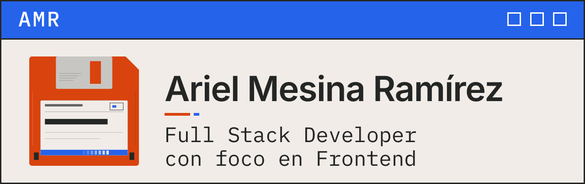

<picture>
  <source media="(prefers-color-scheme: dark)" srcset="assets/banner-oscuro.svg">
  <source media="(prefers-color-scheme: light)" srcset="assets/banner-claro.svg">
  
</picture>

Aquí están mis proyectos de código en GitHub. Los casos UX/UI y el CV están en elari.work.

- [Proyectos de código](https://mrkanoh.github.io)
- [Portafolio UX/UI](https://elari.work)
- [CV](https://elari.work/cv/)
